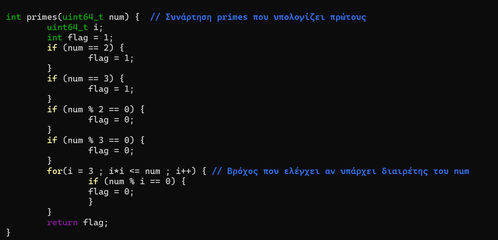
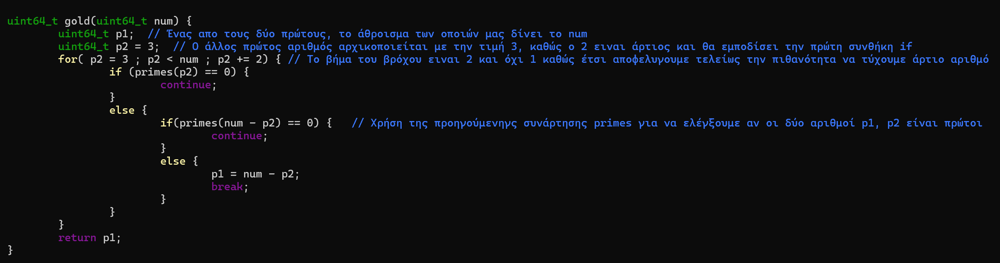
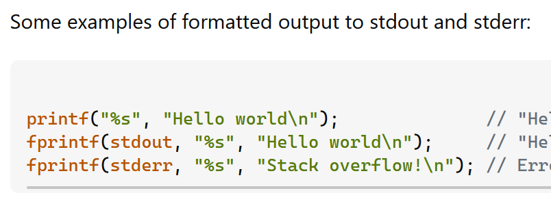
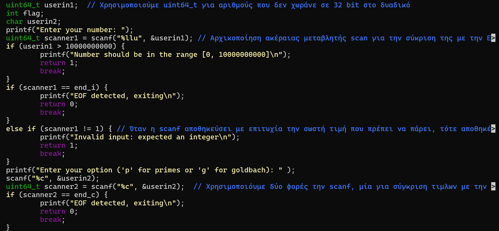

# Η δικιά μου προσέγγιση για αυτό το πρόβλημα

Στον δικό μου κώδικα C σχετικά με την εικασία του Goldbach εχώ επιλέξει την παρακάτω προσέγγιση:  

# 1. Χρήση Βιλβιοθηκών
- Η πρώτη και πιο χρήσιμη βιβλιοθήκη που εχω συμπεριλάβει ειναι η stdio.h που κάθε πρόγραμμα C χρειάζεται. 

- Η επόμενη βιβλιοθήκη που έχουμε αξιοποιήσει ειναι η "stdint.h". Μέσω αυτής, μας δίνετε η δυνατότητα να αρχικοποιήσουμε μεταβλητές ακερραίων των 64 bit, πράγμα που θα φανεί χρήσιμο για τον έλεγχο μεγάλων αριθμών. 

# 2. Δευτερεύων συναρτήσεις
- Πρώτη συνάρτηση που ορίσουμε είναι η primes, μέσω της οποίας γίνεται ο έλεγχος για ύπαρξη πρώτου αριθμού. Μέσα σε αυτήν συναντάμε μια αρχικοποιημένη μεταβλήτη με όνομα "flag", η τιμή της οποίας μεταβάλλεται ανάλογα με το αν ο αριθμός εισδόδου του χρήστη είναι πρώτος ή οχι. Τέλος η συνάρτηση επιστρέφει την εκάστοτε τιμή της "flag". 

Για την ελαχιστοποίηση του χρόνου εκτέλεσης του προγράμματος, έχουν εφαρμοστεί κάποιοι "έξπυνοι κανόνες" στην primes. Αρχικά, εξαιρούνται οι άρτιοι αριθμοί και οι αριθμοί που διαιρούνται τέλεια με το 3. Έπειτ,α για την εύρεση τυχόν διαιρέτη της τιμής εισόδου, ελέγχουμε αριμθούς μέχρι και τη ρίζα της τιμής εκείνης καθώς έαν δεν υπάρχει διαιρέτης μέχρι αυτό το σημείο, τότε μπορούμε να είμαστε σίγουροι ότι δεν θα υπάρξει άλλος πάνω απο την ρίζα.
 

- Δεύτερη συνάρτηση που ορίζουμε ειναι η gold, μέσω της οποίας βρίσκουμε τον μικρότερο συνδυασμό πρώτων που το άρθοισμά τους ισούται με τον άρτιο αριθμό εισόδου του χρήστη. Δηλώνουμε δύο μεταβλητές p1, p2 (short for primes), διατρέχοντας τον έναν απο αυτούς σε ενα for loop με βήμα 2. 

Αρχικά, γίνεται έλεγχος για το αν ο p2 είναι πρώτος, καλώντας την προήγουμενη συνάρτηση primes.  
Αν πράγματι είναι πρώτος, τότε, το πρόγραμμα ελέγχει αν η διαφορά του αριθμού εισόδου με τον p2 είναι πρώτος, και αν είναι και αυτή, τότε η τιμή αποθηκεύεται στον p2.  
Τέλος, η συνάρτηση επιστρέφει την τιμή του p1, με τη βοήθεια της οποίας υπλογίζουμε στην main και τον δεύτερο πρώτο. (τον p2)
 
Τέλος, ορίσαμε τη συνάρτηση ως unsigned integer 64 bit κάθως ενδέχεται η τιμή του p1 που επιστρέφει να μη χωράει στα 32 bit που προσφέρει η int. 

# 3. Συνάρτηση main
Για διεκόλυνση στην εξήγηση της main, θα σπάσουμε αυτή τη θεματική σε μπούλετς.   

- Αρικοποιηούμε δύο ακέραιες μεταβλητές των 64 bit με τιμή εκείνη του EOF. Θα εξηγήσουμε παρακάτω γιατί είναι ακέραιες των 64 bit  

- Χρησιμοποιούμε το %llu ως format specifier καθώς υπάρχει πιθανότητα να χρειαστεί να εκτυπώσουμε αριθμό που χωράρει μόνο σε 64 bit. Ασχολούμαστε αποκλειστικά με μη προσημασμένους ακεραίους (unsigned integers), καθώς σε περίπτωση αρνητικής εισόδου θα εκτυπωθεί στο stderr το αντίστοιχο μήνυμα.   

- Κάνουμε χρήση της συνάρτησης fprintf, η οποία παίρνει δύο ορίσματα. Σε αυτλην την περίπρωση αξιοποιύμε το γεγονός οτί μπορούμε να εκτυπώσουμε απευθείας στο stderr. (π.χ. fprintf(stderr, "Hello World");. (Πηγή έμπνευσης: stackoverflow.com)
 

*Σημείωση: Την σύναρτηση fprintf την χρησιμοποίησα στο πρόγραμμα μου πριν αναφερθεί στην Δίλαλεξη 9. Γι' αυτό έκανα αναφορά στην πηγή.   
 
- Αποθηκεύουμε την τιμή του αριθμού προς υπολογισμό στην μεταβλητή userin1 μέσω της scanf η οποία έχει αποθηκευτεί και αυτή σε ακέραια μεταβλητή των 64 bit. Αυτο συμβαίνει διότι επιθυμούμε να δούμε αν η τιμής της EOF ταυτίζεται με εκείνη της scanner1 προκειμένου να εκτυπώσουμε το ζητούμενο μήνυμα και να τερματίσει το πρόγραμμα. Συνεπώς, για να συγκριθούν πρέπει να έχουν τον ίδιο τύπο μεταβλητής. Η ίδια λογική επαναλαμβάνεται και για την μεταβλητή επιλογλης prime ή goldbach.
 

- Μετά αρχίζουν οι υπολογισμοί, ανάλογα με την επιλογή του χρήστη, δηλαδή είτε "check for prime number" είτε "check if goldbach's conjecture is applicable".   

- Τέλος, αν ο χρήστης εισάγει λανθασμένες εισόδους, το πρόγραμμα εκτυπώνει τα αντίστοιχα μηνύματα.   

Δυστυχώς δε μπόρεσα να βρω τρόπο να περάσω το test για many primes. Ο πιο "γρήγορος" τρόπος που μπορούσα να βρω είναι εκείνος που αναγράφεται στην ενότητα "Δευτερέον Συναρτήσεις" κάτω απο το δεύτερο μπούλετ.

*Σημείωση: Το README.md των bytes το έγραψα στα αγγλικά καθώς δούλευα μέσω των linux PC της σχολής (ssh sdiXXXXXX@linux...) και για κάποιο λόγο ήταν μη αποδεκτοί οι ελληνικοί χαρακτήρες. Ευτυχώς στο WSL μπορώ να πληκτρολογήσω στα Ελληνικά ;)
